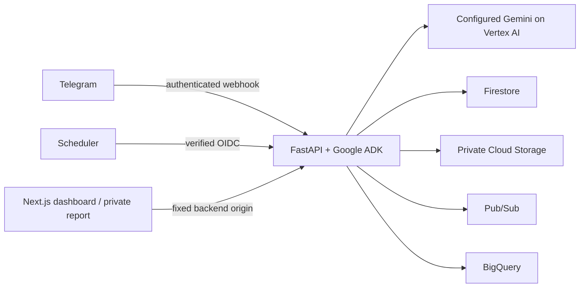

# HighGround

HighGround helps small shops prepare for and document flood impacts through Telegram, a map dashboard and private recovery estimates. The current implementation runs locally; hosting and deployed phone acceptance remain deferred. Synthetic observations, virtual recipients and still-derived videos are explicitly labeled. They do not establish real-shop valuation accuracy, message authenticity or route safety.



## Install and configure

Use Python 3.12, Node.js 24 and npm 11. Tested host versions are Python 3.12.13, Node 24.14.0 and npm 11.9.0. Run from the repository root:

```sh
python3.12 -m venv .venv
.venv/bin/python -m pip install --no-deps -r api/requirements.txt
.venv/bin/python -m pip check
npm --prefix web ci
cp .env.example .env
chmod 600 .env
cp web/.env.example web/.env.local
```

Keep private configuration ignored. Set the explicit HighGround project, Vertex location and `GEMINI_FAST_MODEL` / `GEMINI_PRO_MODEL`; no model ID is hardcoded. Supply the bot token, webhook secret, `HASH_SALT` and `DEMO_OPERATOR_TOKEN` privately. Configure public bot username, an identifiable geocoding user agent, local bucket, topic and dataset. See [.env.example](.env.example) and [local environment notes](docs/planning/local-environment.md). A health-only process can run without these credentials; full Telegram/model/media behavior cannot.

For the existing local service layout, add these endpoint values to the private `.env` or export them in the test shell:

```dotenv
FIRESTORE_EMULATOR_HOST=127.0.0.1:8787
PUBSUB_EMULATOR_HOST=127.0.0.1:8797
STORAGE_EMULATOR_HOST=http://127.0.0.1:4443
BIGQUERY_EMULATOR_HOST=http://127.0.0.1:9050
```

The test runner reads only these endpoint values from `.env`, without sourcing shell code; existing environment values take precedence and must match the loopback layout. Production credentials must never be replaced by anonymous credentials for cloud endpoints. Local models still call Vertex using explicit project/ADC; emulators do not emulate Gemini.

## Local services and application

Inspect emulator ownership/configuration without changing anything:

```sh
python3 infra/emulators.py status
```

The runner pins four images and publishes only loopback ports. Firestore/Pub/Sub use the Google CLI 588.0.0 emulator image with bounded Java heaps. GCS uses fake-gcs-server 1.56.1. BigQuery uses goccy 0.8.1 with bounded Go/container memory and the retained `highground-bigquery-recovered-data` volume. `start` creates missing services or starts stopped matching containers; it refuses existing unbounded/mismatched configuration instead of silently replacing it:

```sh
python3 infra/emulators.py start
```

Root completed a separately coordinated bounded Pub/Sub/GCS replacement and verified restored fixture buckets/original byte hashes and topics. All four current services match the bounded configuration. The old containers remain retained; the runner performs no automatic migration. It requires the retained BigQuery volume to already exist rather than silently creating a replacement. For a genuinely fresh installation with no current/historical HighGround BigQuery containers or retained volumes:

```sh
python3 infra/emulators.py start --service bigquery --initialize-new-data
```

This explicit opt-in creates a labeled new volume; it refuses existing retained data. It must not be used to replace a missing/lost development database. Application resources still require their separately reviewed local initialization. Existing recovered development data must not be overwritten.

After services are available, inspect configured application resources separately:

```sh
.venv/bin/python infra/local_setup.py
```

With explicit local fixture initialization intent, create only absent resources:

```sh
.venv/bin/python infra/local_setup.py --apply
```

This requires `LOCAL_DEVELOPMENT=true`, `DEMO_MODE=true` and all four loopback emulator endpoints. Configure project, topic, dataset and the local bucket naming convention `highground-media-<configured-project>` privately. The initializer inspects all five reviewed table schemas before creating anything and refuses incompatible existing resources. It never drops, reseeds or migrates tables; the naming convention does not prove IAM ownership or emulator durability. Starting emulators and initializing resources remain separate explicit operations.

`python3 infra/emulators.py stop` refuses to stop ephemeral Firestore, Pub/Sub or GCS data without `--ack-disposable-data`. Use that acknowledgment only when those records/uploads are explicitly disposable. `--service bigquery` scopes an operation to that exact container. The runner never removes containers or volumes, never selects stopped OOM containers by prefix, and checks identity again before mutation. Firestore/GCS export or restart durability has **not** been established. Stopping/restarting those processes can lose records/originals; restarting only the application retains state in a still-running emulator.

Before seeding, set `LOCAL_DEVELOPMENT=true`, `DEMO_MODE=true` and `DEMO_VIRTUAL_DELIVERY=true` in the ignored `.env`, with all four loopback endpoints and initialized resources. Use the reviewed current application; stop any older API process before introducing virtual fixtures. Seed the local scenario explicitly:

```sh
.venv/bin/python -m api.demo_seed
```

This creates six clearly synthetic shops, three vehicles, synthetic inventory estimates and original-media receipts. Default recipients are virtual: no Telegram messages or confirmations are invented. Repeating the command preserves existing fixture identities, originals and an explicit owner binding; it does not reset the scenario. Use the dashboard's authenticated reset control to start a new generation while retaining historical evidence.

For a real alert demonstration, first complete ordinary Telegram onboarding with a consenting owner. Then explicitly bind one fixture to that existing private registration:

```sh
.venv/bin/python -m api.demo_seed --bind-fixture 1 --registered-shop EXISTING_REGISTRATION --consenting-owner
```

Replace `EXISTING_REGISTRATION` with the known registration identifier, never a guessed chat ID. This binding permits synthetic alerts and their confirmations only; ordinary baseline/photo/recovery ownership remains with the original registration. Remaining fixtures stay virtual. The bound owner can receive subsequent simulated alerts, so bind only with their consent. Keep private registration identifiers out of public artifacts.

Start the API with access logging disabled to avoid logging private report paths:

```sh
.venv/bin/python -m uvicorn api.main:app --host 127.0.0.1 --port 8000 --no-access-log
```

Set `HIGHGROUND_API_ORIGIN=http://127.0.0.1:8000` in `web/.env.local` (server-only), then in another terminal:

```sh
npm --prefix web run dev -- --port 3001
```

Open [the dashboard](http://127.0.0.1:3001). Port 3000 may belong to another application. The public dashboard shows synthetic records only; missing analytics show unavailable rather than zero. Enter the operator bearer manually for simulation/reset controls; it stays in client memory. A private report link has `/report/<opaque-id>#key=<capability>`; a report ID alone grants no access. Media and integrity checks require the same report-bound authorization header. Tokens must not be copied into query parameters, logs or public settings.

The API's `/healthz` reports process liveness only. Telegram testing requires an explicitly approved tunnel and the existing `infra/set_webhook.sh` helper; starting the app does not register a webhook. Local polling operator bypass additionally requires explicit demo/local settings and the loopback Firestore emulator. Hosted polling uses exact verified OIDC audience and caller identity.

Pending dispatch, confirmation analytics and stored-original evidence-ledger work can be resumed manually through authenticated `POST /jobs/resume-pending`. For local operator use, explicitly configure `SCHEDULER_LOCAL_AUTH=true`, `LOCAL_DEVELOPMENT=true`, `DEMO_MODE=true`, the private operator token and loopback Firestore/Pub/Sub/BigQuery endpoints. This example reads settings without shell-sourcing `.env` or putting the token in a URL:

```sh
.venv/bin/python - <<'PYTHON'
import os
import httpx
from api.config import load_settings
from api.tools.emulators import loopback_endpoint
settings = load_settings()
origin = loopback_endpoint(os.environ.get('API_BASE_URL', 'http://127.0.0.1:8000'), http=True)
response = httpx.post(origin + '/jobs/resume-pending',
    headers={'Authorization': 'Bearer ' + settings.operator_token},
    json={'limit': 10}, timeout=45)
response.raise_for_status()
print(response.json())
PYTHON
```

The response reports private-identifier-free outcomes for three independent stages, with at most20 entries per stage and a30-second response deadline. `deadline_limited`/`inflight_unknown` means underlying work may still be running; retry is governed by durable leases and logical identities. Missing-original uploads are not redownloaded, and already accepted/uncertain messages are not blindly resent. This is **manual recovery**, not a running automatic schedule. Hosted scheduling stays deferred. [Recovery evidence and exact bounds](docs/planning/task-17-recovery-verification.md) record the protected outage/replay tests and query-result cleanup.

## Verify

```sh
./infra/test.sh
```

Default **full** mode checks all four exact endpoint configurations and reachability, runs infrastructure/API tests, and rejects any skipped API test through the actual JUnit result. It then runs frontend behavior tests, lint, type checks and the production build. It does not start services or seed/delete resources. Serialize heavy emulator/model checks with other development work; BigQuery has previously accumulated temporary results and exhausted memory.

For deliberately limited verification without integration services:

```sh
./infra/test.sh --unit
```

This explicitly disables emulator endpoints for API tests, labels the run unit-only and permits documented integration skips. It is not full Must acceptance. Neither command proves live model accuracy, two-phone acceptance, cloud IAM or deployed behavior. Model-specific/live journey checks are recorded separately in task verification notes.

For production frontend testing, build before starting the server so a development process does not share `.next` during the build:

```sh
npm --prefix web run build
npm --prefix web run start -- --port 3001
```

## Safety and evidence limits

Danger uses committed templates with deterministic listed destinations and no runtime model prose or requests for stock/videos. Historically sourced destination designation is distinct from current opening status; unknown remains unknown. Official observation freshness is configurable from 1 to 90 minutes and missing/stale sources never imply all-clear. Vehicle action targets precede stock targets.

Confirmations are self-reported: vehicles count once per shop/episode, and estimated stock value uses the maximum displayed confirmed immutable snapshot per shop/episode, then sums across shops. Telegram acceptance is not a read receipt. Recovery reports exclude unknown item losses and label partial totals. File hashes check stored bytes, not recording authenticity, time, location or insurer acceptance. Original media is private and evidence receipts are retained.

The reviewed local scenario has passed real emulator seeding, protected manual recovery, production dashboard/reset/retry checks and one consenting Telegram owner’s vehicle/stock confirmations. Virtual alerts are counted separately from real Telegram API acceptance; reported actions are not independently verified physical outcomes. The complete local Must gate remains open for actual report PDF/print verification. Real Telegram media-upload permission, second-phone and hosted acceptance remain pending; Should implementation has not started. See the [operational checkpoint](docs/planning/task-17-operational-verification.md) for exact evidence and limitations.

## Packaging, deployment and attribution

[Task 14 packaging evidence](docs/planning/task-14-verification.md) records digest-pinned non-root images and root's actual local image checks. `infra/deploy.sh` defaults to dry-run and requires explicit hosting authorization plus explicit project/region/images/service accounts/config/Secret Manager versions to execute. It does not provision resources, replace webhooks or change Scheduler jobs. Hosted acceptance remains pending. No GitHub Actions, Dependabot or repository-connected Cloud Build triggers are included.

Built with FastAPI, Google ADK, Gemini on Vertex AI, Firestore, Cloud Storage, Pub/Sub, BigQuery, Next.js, Tailwind, Leaflet and OpenStreetMap. Development Storage/BigQuery emulators are third-party tools and do not prove cloud IAM, signed-link expiry or production compatibility. Local Source Sans 3 is bundled under the SIL Open Font License; see [font license](web/public/licenses/source-sans-3.txt). Repository code is MIT: [LICENSE](LICENSE).
